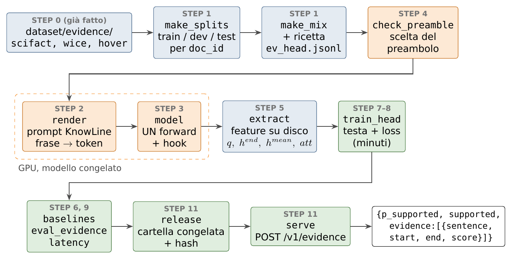

# Fact checking con evidenza per frase — documentazione dell'implementazione

 Il piano di partenza, con tutte le varianti (altri modelli, dati generati, fase 2), è in [`../../fine_tuning_factcheck_evidence_complete/`](../../fine_tuning_factcheck_evidence_complete/testa_per_frase/00_overview.md). La guida pratica ai comandi è [`evidence/code_report.md`](../../../evidence/code_report.md).

## 1. Che cosa fa il sistema

Un **decision model** (KnowLine-4B) riceve un documento e un claim e, con **un solo passaggio sul testo** (un *forward*, senza generare token), dà

$$
P(\text{supportato}) = \sigma(\ell_A - \ell_B),
$$

dove $\ell_A$ e $\ell_B$ sono i log-punteggi delle etichette "A. Yes" e "B. No" all'ultimo token del prompt.

Aggiungiamo una piccola rete, la **testa di evidenza** (tra i 3 e i 5 M di  parametri contro i vs i billion (4b) del modello).
 Dagli stati interni calcolati **in quello stesso forward**, assegna a ogni frase $k$ del documento un punteggio $s_k$ e, al documento intero un'altro punteggio $s_\star$. Le frasi con $s_k > s_\star$ sono l'evidenza:

```json
{"p_supported": 0.9987, "supported": true,
 "evidence": [{"sentence": 0, "start": 0,   "end": 77,  "score": 0.83,
               "text": "Saint Paul School of Theology is a seminary located in Kansas City, Missouri."},
              {"sentence": 4, "start": 185, "end": 259, "score": 0.61,
               "text": "Nancy R. Howell is Professor of Theology at Saint Paul School of Theology."}]}
```

(Risposta reale del server, `python -m evidence.serve --demo`, con una testa addestrata su 300 righe. Claim: *"Nancy R. Howell teaches at a seminary in Kansas City."*)

Il caso difficile è l'**evidenza sparsa**: due frasi lontane che dimostrano il claim **solo insieme**. Nell'esempio, la frase 0 non nomina Nancy Howell e la frase 4 non nomina Kansas City.

Tre principi:

1. **Un solo forward.** La testa usa vettori che il modello calcola comunque. 
2. **Il verdetto non cambia.** Il modello di base ( decision model) è congelato e si addestra solo la testa.
3. **Attn non causale.** transformer **non causale** s.t. frase 0 vede anche frase 4

## 2. La pipeline



*Figura 1 — I passi e i file che li realizzano. Arancione: richiede il modello sulla GPU. Verde: solo la testa (minuti, anche su CPU).*

| # | Passo | Documento | Codice |
|--------|-------------------------------------------|------------------|-------------------------------------------------|
| 0 | Dataset con evidenza annotata | [02](02_dati_fonti.md) | `evidence/data/build.py`, `evidence/sentences.py` |
| 1 | Split per documento e mix di training | [04](04_split_e_mix.md) | `evidence/data/make_splits.py`, `evidence/data/make_mix.py` |
| 2 | Prompt di KnowLine e posizione delle frasi nei token | [05](05_formato_prompt.md), [06](06_rendering_ed_estrazione.md) | `evidence/render.py` |
| 3 | Forward con gli hook | [01](01_modello_e_hook.md) | `evidence/model.py` |
| 4 | Scelta del preambolo | [05](05_formato_prompt.md) | `evidence/check_preamble.py` |
| 5 | Estrazione delle feature su disco | [06](06_rendering_ed_estrazione.md) | `evidence/extract.py`, `evidence/features.py` |
| 6 | Baseline | [07](07_baseline.md) | `evidence/baselines.py` |
| 7 | Architettura della testa e loss | [08](08_testa_e_loss.md) | `evidence/head.py`, `evidence/losses.py` |
| 8 | Training | [09](09_training.md) | `evidence/train_head.py`, `evidence/configs/*.json` |
| 9 | Valutazione e latenza | [10](10_valutazione.md) | `evidence/eval_evidence.py`, `evidence/metrics.py`, `evidence/latency.py` |
| 10 | Esperimenti | [11](11_esperimenti.md) | `evidence/configs/`, `evidence/recipes/` |
| 11 | Rilascio e server | [12](12_export_e_servizio.md) | `evidence/release.py`, `evidence/serve.py` |
| — | Comandi e checklist | [13](13_checklist.md) | |
| — | Cosa non è implementato | [14](14_strada_da_esplorare.md) | |
| — | Tutte le formule in una pagina | [15](15_recap_architettura_layer_loss.md) | |

Il passo [03](03_dati_generati.md) (dati generati) è fuori dal perimetro dell'implementazione.

## 3. Notazione

| Simbolo | Significato | Valore per KnowLine-4B |
|-------------------|-----------------------------------------------------|---------------------------------|
| $T$ | posizione dell'ultimo token del prompt (**posizione di risposta**) | |
| $D$ | dimensione degli stati nascosti | 2.560 |
| $H^{(l)} \in \mathbb{R}^{(T+1)\times D}$ | uscita del layer $l$ (un vettore per token) | |
| $\mathcal{L}$ | layer da cui si leggono le frasi | $\{19, 23, 27, 31\}$, $L = \lvert\mathcal{L}\rvert = 4$ |
| $\mathcal{F}$ | layer ad attenzione piena | $\{3, 7, 11, \ldots, 31\}$ (8 layer) |
| $n$ | frasi del documento | mediana 46 nel mix, massimo 512 |
| $[a_k, b_k]$ | primo e ultimo token della frase $k$ nel prompt | |
| $n_k = b_k - a_k + 1$ | token della frase $k$ | |
| $h^{end}_k, h^{mean}_k \in \mathbb{R}^{L\times D}$ | ultimo token e media dei token della frase $k$, nei layer di $\mathcal{L}$ | |
| $q \in \mathbb{R}^{L\times D}$ | stato della posizione di risposta, nei layer di $\mathcal{L}$ | |
| $att_k \in \mathbb{R}^{128}$ | attenzione che la posizione di risposta dà alla frase $k$ (8 layer × 16 teste) | |
| $d$ | dimensione interna della testa | 256 |
| $s_k$, $s_\star$ | punteggio della frase $k$; soglia del documento (`s0` nel codice) | |
| $G$ | insieme delle frasi gold di una riga (unione degli insiemi alternativi) | |
| $\omega$ | peso delle frasi **non** gold nella loss | 0,3–1 |
| $\delta$ | spostamento della soglia scelto sul dev | $[-1, 1]$ |

## 4. Stato dell'implementazione (2026-11-04)

| Parte | Stato |
|----------------------------------------------|--------------------------------------------------------|
| Split e mix | lanciati: `dataset/evidence/splits/`, `dataset/evidence/mixes/ev_head.jsonl` (20.249 righe) |
| Rendering, hook, forward | verificati sui dati veri ([06](06_rendering_ed_estrazione.md) §8, [01](01_modello_e_hook.md) §6) |
| Testa, loss, metriche | test unitari superati (`tests/test_evidence_head.py`) |
| Estrazione, baseline, training, valutazione, server, latenza | provati end-to-end su 300 righe |
| Estrazione completa (circa 2,5 h, circa 50 GB), esperimenti | **da lanciare** ([13](13_checklist.md)) |

I numeri che compaiono in questa documentazione come "prova su 300 righe" dicono solo che la pipeline funziona. I risultati veri richiedono l'estrazione completa.

## 5. Obiettivi (dal piano)

| Obiettivo | Soglia | Come si misura |
|------------------------------|------------------------------------------------------|-------------------------------------|
| Verdetto invariato | identico a quello senza testa | `eval_evidence.py`, sezione `verdict` |
| F1 per frase | almeno 15 punti sopra E-LEX | `baselines.py` contro `eval_evidence.py` |
| Insieme completo su HoVer | ≥ 0,65 | `metrics.summarize` → `full_set`, `by_source` |
| Evidenza lontana | F1 con gold a ≥ 20 frasi di distanza al massimo 5 punti sotto quello delle vicine | `f1_by_sent_distance` |
| Sufficienza | ≥ 85% | `eval_evidence.py --sufficiency` |
| Latenza | ≤ +3% o +2 ms | `latency.py` (misurato: +0,5%) |
