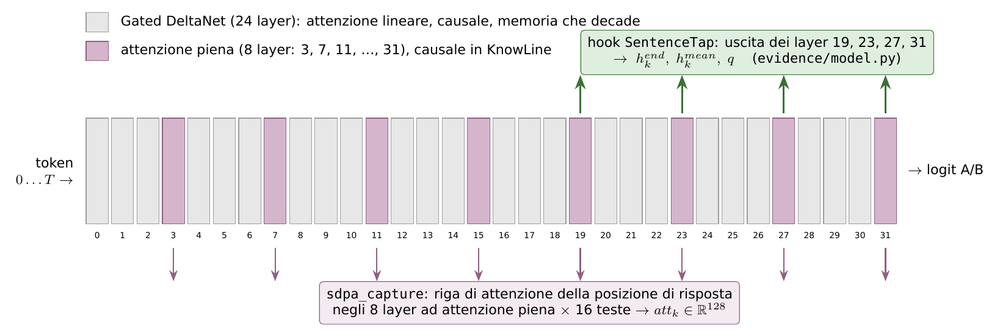
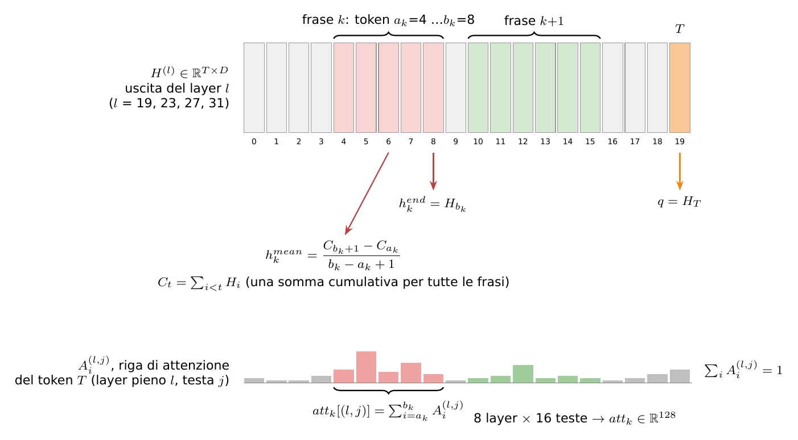

# Passo 1 — Il decision model e gli hook per frase

## In breve

Il verdetto e le feature delle frasi escono dallo **stesso forward** di KnowLine-4B. Il codice ([`evidence/model.py`](../../../evidence/model.py)) non modifica il modello. Aggiunge due cose:

1. **hook** sui layer 19, 23, 27 e 31: mentre il forward passa, riassumono ogni frase in due vettori ($h^{end}_k$, $h^{mean}_k$) e salvano lo stato della posizione di risposta ($q$);
2. una **funzione di attenzione** registrata in transformers (`sdpa_capture`): fa l'attenzione normale e, negli 8 layer pieni, ricalcola una sola riga di pesi, quella della posizione di risposta verso tutti i token. Da questa riga si ricava quanto il modello "guarda" ogni frase ($att_k$).


### COSA CI INTERESSA DEL FORWARD (IL RESTO SON DETTAGLI)
Dalla tabella $H^{(l)}$ di **4 layer** (19, 23, 27, 31) prendiamo, per ogni frase:

- **$h^{end}_k$**: la colonna dell'**ultimo token della frase** (nell'esempio, il token 8, il "."). Siccome il modello è causale, quel token ha letto tutta la frase: è un riassunto naturale.
- **$h^{mean}_k$**: la **media delle colonne** dei token della frase (dal 4 all'8). È un secondo riassunto, che pesa tutti i token allo stesso modo.

>> da provare 
**Media pesata con l'attenzione della risposta.** 

Invece della media semplice, ogni token della frase pesa quanto l'attenzione che gli dà l'ultimo token del prompt:

$$
h^{att}_{k,l} = \frac{\sum_{i \in k} A^{(l,j)}_i \, H^{(l)}_i}{\sum_{i \in k} A^{(l,j)}_i}
$$

Come scegliere? - una regressione logistica per variante, per esempio $h^{end}$, $h^{mean}$ e "end + mean" su ogni layer, che deve riconoscere le frasi gold. Su 500 righe dà in pochi minuti l'AUPRC di ogni variante, prima di addestrare la testa.
>> FINE
- **Pro:** pesa di più i token che il modello ha guardato per decidere (il nome, la data…).
- **Contro:** esiste solo nei layer ad attenzione piena; va scelta la testa $j$, oppure si fa la media sulle 16 teste.
- **Costo:** basso. La riga $A$ c'è già negli hook, quindi non servono i vettori di tutti i token su disco. Va però modificato l'hook.


esempio promt di 20 token.: 
```text
token:     0        1       2   3      4      5     6       7       8    9   ...     19
        "Claim" "under"   ...  ...  "Rose"  "is"  "an"  "actress"  "."  ...   ...  "Answer:"
                                    └──────────── frase k ──────────────┘             ↑
                                     a_k = 4                      b_k = 8      ultimo token T
```


E, una volta per documento:

- **$q$**: la colonna dell'**ultimo token del prompt** (il 19), cioè proprio dove il modello decide il verdetto.

Con i numeri: per un documento di 46 frasi escono `h_end` di forma `[46 frasi, 4 layer, 2560]`, `h_mean` uguale, e `q` di forma `[4 layer, 2560]`.

La formula con $C_t$ (somme cumulative) è solo un **trucco per calcolare velocemente le medie** di tutte le frasi in una volta. Il risultato è identico a "somma i vettori dei token della frase e dividi per quanti sono":

$$
h^{mean}_{k,l} = \frac{1}{n_k}\sum_{i=a_k}^{b_k} H^{(l)}_i = \frac{C_{b_k+1} - C_{a_k}}{b_k - a_k + 1}, \qquad C_t = \sum_{i<t} H^{(l)}_i
$$

**Lo facciamo tramite hook**
Un **hook** è una piccola funzione che si "aggancia" a un layer: PyTorch la chiama automaticamente ogni volta che quel layer ha finito il calcolo, passandole la sua uscita (la tabella $H^{(l)}$). La nostra funzione ritaglia le colonne che servono, le mette da parte, e il forward prosegue identico.

**Riga di attenzione**

```text
prompt → layer 0 → … → layer 19 ──→ … → layer 23 ──→ … → layer 31 ──→ "Yes"/"No"
                          │                 │                 │
                        hook              hook              hook     ← copiano h_end, h_mean, q
```


Nei layer ad attenzione piena, ogni token distribuisce un **100% di attenzione** sui token precedenti. Ci interessa quella dell'**ultimo token** (dove nasce il verdetto): quanta attenzione dà a ogni frase? Per esempio:

```text
token:        0     1     2     3  |  4     5     6     7     8  |  9   ...   19
attenzione:  .01   .01   .01   .02 | .04   .10   .05   .07   .03 | .01  ...  .03     (somma = 1)
                                   └──────── frase k: 0,29 ──────┘
```

La quota della frase $k$ è la somma sui suoi token, qui 0,29: "per decidere, questa testa ha guardato per il 29% la frase $k$". Lo facciamo per **8 layer × 16 teste = 128 numeri** per frase: è $att_k$.

$$
att_k[(l, j)] = \sum_{i=a_k}^{b_k} A^{(l,j)}_i, \qquad \sum_{i=0}^{T} A^{(l,j)}_i = 1
$$
dove:
* l e' il layer
* j e' la testa j-esima all'interno di quel layer (e' un MHA)
* $a_k$ e $b_k$ sono il primo e l'ultimo token della frase k
* $A^{(l,j)}_i$ quanta attenzione, l'ultimo token del prompt ( T) da al tokan i, nel layer l, nella testa j
* $att_k[(l, j)]$ quanta parte di tutta l'attenzione ricevono i token della frase k.
* La coppia $(l, j)$ individua una delle 128 componenti del vettore $att_k$: 8 valori possibili di $l$ per 16 valori di $j$ fanno 128. 

**Perché serve `sdpa_capture`.** L'attenzione veloce di PyTorch calcola il risultato ma **non restituisce questi pesi**. Chiederli tutti (modalità "eager") vorrebbe dire ogni token verso ogni token: con 16.000 token sono miliardi di numeri, troppi per la memoria. A noi serve **una sola riga**, quella dell'ultimo token. Così `sdpa_capture`:

1. fa l'attenzione normale (il modello va avanti identico);
2. ricalcola a parte solo quella riga e la salva.

Il dettaglio "4 teste di chiavi, 16 di query" (`repeat_interleave`) è un'ottimizzazione di Qwen: ogni gruppo di 4 teste di query condivide le stesse chiavi. Il codice si limita a ricopiarle per fare il conto.


## 1. Il modello: KnowLine-4B-Gen5.5 su Qwen3.5

KnowLine-4B (`PelaAI/KnowLine-4B-Gen5.5`, revisione `779944d`) è un Qwen3.5-4B fine-tunato dagli autori come decision model. Le impostazioni sono in [`evidence/config.py`](../../../evidence/config.py) (`MODEL_REPO`, `MODEL_REVISION`).

| Parametro (`config.json` dello snapshot) | Valore |
|--------------------------------------|----------------------------------------------|
| layer | 32 |
| dimensione $D$ | 2.560 |
| layer ad attenzione piena | 3, 7, 11, 15, 19, 23, 27, 31 (uno ogni quattro) |
| altri 24 layer | Gated DeltaNet (attenzione lineare) |
| teste di query / di chiavi (layer pieni) | 16 / 4, dimensione di testa 256 |
| DeltaNet: teste di valore / di chiave | 32 / 16, dimensione 128, convoluzione causale di ampiezza 4 |
| MLP | 9.216 (SwiGLU) |
| vocabolario | 248.320 |



*Figura 2 — I 32 layer. In viola i layer ad attenzione piena. Le frecce verdi indicano i layer da cui gli hook leggono le frasi; quelle viola le righe di attenzione catturate.*

### 1.1 Un layer, in formule

Ogni layer aggiorna il **flusso residuo** $H^{(l)} \in \mathbb{R}^{(T+1)\times D}$ (un vettore per token):

$$
\tilde H = H^{(l-1)} + \mathrm{Mixer}_l\big(\mathrm{RMSNorm}(H^{(l-1)})\big), \qquad
H^{(l)} = \tilde H + \mathrm{MLP}_l\big(\mathrm{RMSNorm}(\tilde H)\big).
$$

>>$H^{(l)}$ sono gli embedding dei token al layer l. Knowline ha 32 layer. Per ogni token, ogni layer produce un embedding di 2.560. Il verdetto (§1.2). Dopo l'ultimo layer, il modello guarda solo la colonna dell'ultimo token ("Answer:") e chiede: è più probabile che il prossimo token sia "A" (Yes) o "B" (No)? Da lì esce P(supportato).

Il *mixer* è l'unico punto in cui un token riceve informazione dagli altri. Ce ne sono di due tipi.

**Attenzione piena** (layer in $\mathcal{F}$, con *gate* d'uscita). Per la testa $j$, che usa la testa di chiavi $g(j) = \lfloor j/4 \rfloor$ (*grouped-query attention*):

$$
\mathbf{q}^{(j)}_t = \mathrm{RoPE}\big(\mathrm{RMSNorm}(W^{(j)}_Q x_t)\big),\quad
\mathbf{k}^{(g)}_i = \mathrm{RoPE}\big(\mathrm{RMSNorm}(W^{(g)}_K x_i)\big),
$$

$$
A^{(j)}_{t,i} = \frac{\exp\big(\mathbf{q}^{(j)}_t \cdot \mathbf{k}^{(g(j))}_i / \sqrt{256}\big)}{\sum_{i' \le t} \exp\big(\mathbf{q}^{(j)}_t \cdot \mathbf{k}^{(g(j))}_{i'} / \sqrt{256}\big)}\quad (i \le t),\qquad
o_t = W_O\Big[\big(\textstyle\sum_{i\le t} A^{(j)}_{t,i}\, \mathbf{v}^{(g(j))}_i\big)_j \odot \sigma(W_G x_t)\Big].
$$

In KnowLine l'attenzione è **causale**: il token $t$ vede solo i token $i \le t$.

**Gated DeltaNet** (gli altri 24 layer). Non c'è una matrice di attenzione: ogni testa porta avanti uno **stato** $S_t \in \mathbb{R}^{128\times128}$, aggiornato token per token con la *delta rule*:

$$
S_t = \alpha_t\, S_{t-1}\big(I - \beta_t\, \mathbf{k}_t \mathbf{k}_t^\top\big) + \beta_t\, \mathbf{v}_t \mathbf{k}_t^\top,\qquad o_t = S_t\, \mathbf{q}_t,
$$

con $\alpha_t = \exp(g_t) \in (0,1)$ (decadimento appreso: la memoria si affievolisce) e $\beta_t = \sigma(\cdot) \in (0,1)$ (forza della scrittura). Anche questo è **causale**, e in più con memoria che decade.

**Conseguenze per la testa:**

- Quando il modello legge la frase $k$, non ha ancora visto le frasi successive. È per questo che la testa ha un transformer non causale sulle frasi ([08](08_testa_e_loss.md) §3.C).
- Leggere subito **dopo un layer pieno** (19, 23, 27, 31) dà il vettore più aggiornato: ha appena "guardato" esplicitamente tutto il testo precedente, compreso il claim del preambolo ([05](05_formato_prompt.md)).


### COSA CI INTERESSA DEL FORWARD (IL RESTO SON DETTAGLI)
Dalla tabella $H^{(l)}$ di **4 layer** (19, 23, 27, 31) prendiamo, per ogni frase:

- **$h^{end}_k$**: la colonna dell'**ultimo token della frase** (nell'esempio, il token 8, il "."). Siccome il modello è causale, quel token ha letto tutta la frase: è un riassunto naturale.
- **$h^{mean}_k$**: la **media delle colonne** dei token della frase (dal 4 all'8). È un secondo riassunto, che pesa tutti i token allo stesso modo.

esempio promt di 20 token.: 
```text
token:     0        1       2   3      4      5     6       7       8    9   ...     19
        "Claim" "under"   ...  ...  "Rose"  "is"  "an"  "actress"  "."  ...   ...  "Answer:"
                                    └──────────── frase k ──────────────┘             ↑
                                     a_k = 4                      b_k = 8      ultimo token T
```


E, una volta per documento:

- **$q$**: la colonna dell'**ultimo token del prompt** (il 19), cioè proprio dove il modello decide il verdetto.

Con i numeri: per un documento di 46 frasi escono `h_end` di forma `[46 frasi, 4 layer, 2560]`, `h_mean` uguale, e `q` di forma `[4 layer, 2560]`.

La formula con $C_t$ (somme cumulative) è solo un **trucco per calcolare velocemente le medie** di tutte le frasi in una volta. Il risultato è identico a "somma i vettori dei token della frase e dividi per quanti sono":

$$
h^{mean}_{k,l} = \frac{1}{n_k}\sum_{i=a_k}^{b_k} H^{(l)}_i = \frac{C_{b_k+1} - C_{a_k}}{b_k - a_k + 1}, \qquad C_t = \sum_{i<t} H^{(l)}_i
$$

**Lo facciamo tramite hook**
Un **hook** è una piccola funzione che si "aggancia" a un layer: PyTorch la chiama automaticamente ogni volta che quel layer ha finito il calcolo, passandole la sua uscita (la tabella $H^{(l)}$). La nostra funzione ritaglia le colonne che servono, le mette da parte, e il forward prosegue identico.

**Riga di attenzione**

```text
prompt → layer 0 → … → layer 19 ──→ … → layer 23 ──→ … → layer 31 ──→ "Yes"/"No"
                          │                 │                 │
                        hook              hook              hook     ← copiano h_end, h_mean, q
```


Nei layer ad attenzione piena, ogni token distribuisce un **100% di attenzione** sui token precedenti. Ci interessa quella dell'**ultimo token** (dove nasce il verdetto): quanta attenzione dà a ogni frase? Per esempio:

```text
token:        0     1     2     3  |  4     5     6     7     8  |  9   ...   19
attenzione:  .01   .01   .01   .02 | .04   .10   .05   .07   .03 | .01  ...  .03     (somma = 1)
                                   └──────── frase k: 0,29 ──────┘
```

La quota della frase $k$ è la somma sui suoi token, qui 0,29: "per decidere, questa testa ha guardato per il 29% la frase $k$". Lo facciamo per **8 layer × 16 teste = 128 numeri** per frase: è $att_k$.

$$
att_k[(l, j)] = \sum_{i=a_k}^{b_k} A^{(l,j)}_i, \qquad \sum_{i=0}^{T} A^{(l,j)}_i = 1
$$
dove:
* l e' il layer
* j e' la testa j-esima all'interno di quel layer (e' un MHA)
* $a_k$ e $b_k$ sono il primo e l'ultimo token della frase k
* $A^{(l,j)}_i$ quanta attenzione, l'ultimo token del prompt ( T) da al tokan i, nel layer l, nella testa j
* $att_k[(l, j)]$ quanta parte di tutta l'attenzione ricevono i token della frase k.
* La coppia $(l, j)$ individua una delle 128 componenti del vettore $att_k$: 8 valori possibili di $l$ per 16 valori di $j$ fanno 128. 

**Perché serve `sdpa_capture`.** L'attenzione veloce di PyTorch calcola il risultato ma **non restituisce questi pesi**. Chiederli tutti (modalità "eager") vorrebbe dire ogni token verso ogni token: con 16.000 token sono miliardi di numeri, troppi per la memoria. A noi serve **una sola riga**, quella dell'ultimo token. Così `sdpa_capture`:

1. fa l'attenzione normale (il modello va avanti identico);
2. ricalcola a parte solo quella riga e la salva.

Il dettaglio "4 teste di chiavi, 16 di query" (`repeat_interleave`) è un'ottimizzazione di Qwen: ogni gruppo di 4 teste di query condivide le stesse chiavi. Il codice si limita a ricopiarle per fare il conto.


### 1.2 Il verdetto

All'ultimo token $T$ il modello produce i logit sul vocabolario, $z = W_U\,\mathrm{RMSNorm}(H^{(31)}_T)$. Con $\ell = \log\mathrm{softmax}(z)$ e le etichette A ("Yes") e B ("No"):

$$
P(\text{supportato}) = \frac{e^{\ell_A}}{e^{\ell_A} + e^{\ell_B}} = \sigma(\ell_A - \ell_B).
$$

La temperatura di calibrazione degli autori (1,5) è già inclusa nei pesi. La soglia è $0{,}5$ (`config.VERDICT_THRESHOLD`). Codice: `model.p_supported(answer_logits)`. Gli id delle etichette vengono da `knowline_layout.labels_and_ids`, attraverso `render.frontend()`.

Si calcolano solo i logit dell'ultima posizione (`logits_to_keep=1`), come fa l'adapter del benchmark ([`models/knowline-4b/adapter.py`](../../../models/knowline-4b/adapter.py), `hf_score`). I logit di tutte le posizioni occuperebbero circa 0,5 MB per token.

## 2. Caricamento

`model.load_model(device)` carica il modello come `knowline_server.HF`: classe multimodale di transformers, bf16, `device_map`, con una differenza, `attn_implementation="sdpa_capture"`. Prima di caricarlo, `register_attention()` registra la funzione in `transformers.AttentionInterface`. I pesi sono congelati (`requires_grad_(False)`). `text_layers(model)` trova la `ModuleList` dei 32 layer testuali (il modello ha anche una torre visiva, che si esclude).

Servono `flash-linear-attention` (`fla`) e `causal-conv1d`: transformers 5.17 li usa automaticamente per i layer DeltaNet (`use_kernel_func_from_hub_with_fallback`). Senza, il forward è molto più lento.

## 3. Gli hook: riassunto delle frasi



*Figura 3 — In alto: dall'uscita di un layer si ricavano, per la frase $k$ (token $a_k \ldots b_k$), l'ultimo token e la media; $q$ è lo stato della posizione di risposta. In basso: la riga di attenzione del token $T$, sommata sui token della frase.*

Per ogni layer $l \in \mathcal{L} = \{19, 23, 27, 31\}$, un *forward hook* (`SentenceTap._hook`) riceve $H^{(l)}$ e calcola subito, sulla GPU:

$$
h^{end}_{k,l} = H^{(l)}_{b_k}, \qquad
h^{mean}_{k,l} = \frac{1}{n_k}\sum_{i=a_k}^{b_k} H^{(l)}_i = \frac{C_{b_k+1} - C_{a_k}}{b_k - a_k + 1},\quad C_t = \sum_{i<t} H^{(l)}_i, \qquad
q_l = H^{(l)}_T .
$$

- Le somme cumulative $C$ si calcolano una volta sola, in fp32, per tutte le frasi: il costo è $O(TD)$ per layer, indipendente da $n$.
- Esce un tensore $n \times D$ per layer: i vettori di tutti i token **non vengono mai conservati**.
- **Perché due riassunti.** $h^{end}$ è l'ultimo token: in un modello causale ha letto tutta la frase e ciò che la precede. $h^{mean}$ pesa tutti i token allo stesso modo e non dipende dalla punteggiatura finale. In una frase lunga con il fatto rilevante all'inizio, la media ne conserva di più.
- **Perché non solo il layer 31.** L'ultimo layer prepara la predizione del token successivo; nelle posizioni diverse da $T$ può aver già scartato informazione sul contenuto. I layer pieni 19, 23 e 27 la conservano. Quale layer serve lo decide la miscela appresa della testa ([08](08_testa_e_loss.md) §3.A).

## 4. La riga di attenzione

Le implementazioni veloci dell'attenzione (SDPA, flash) non restituiscono i pesi. Chiederli in modalità "eager" costerebbe $16 \times T^2$ numeri per layer: con $T = 16.000$ sono 4 G valori. Ne serve però **una sola riga**: quella della posizione di risposta. `sdpa_capture(module, query, key, value, attention_mask, scaling)`:

1. chiama `sdpa_attention_forward` (l'attenzione normale, che è l'uscita del modello e resta invariata);
2. se il layer è in $\mathcal{F}$, calcola **in fp32**:

$$
A^{(l,j)}_{i} = \mathrm{softmax}_{i}\Big( \mathbf{q}^{(l,j)}_T \cdot \mathbf{k}^{(l,\lfloor j/4\rfloor)}_i \cdot \tfrac{1}{\sqrt{256}} \Big), \qquad i = 0 \ldots T,
$$

   con `key.repeat_interleave(4, dim=1)` per passare dalle 4 teste di chiavi alle 16 di query. Il modello è causale e si lavora con batch 1, quindi l'ultima riga vede tutti i token: non serve maschera. Il codice applica comunque la maschera, se il modello ne passa una;
3. salva $A^{(l,\cdot)} \in \mathbb{R}^{16 \times (T+1)}$ in `CAPTURE["rows"][l]`.

Poi `attention_per_sentence(rows, spans)` somma i pesi sui token di ogni frase, sempre con somme cumulative:

$$
att_k[(l, j)] = \sum_{i=a_k}^{b_k} A^{(l,j)}_i, \qquad (l,j) \in \mathcal{F} \times \{0,\ldots,15\}, \qquad att_k \in \mathbb{R}^{128}.
$$

Siccome $\sum_i A^{(l,j)}_i = 1$, ogni componente è la **quota di attenzione** che la testa $(l, j)$ dà alla frase. Le colonne sono ordinate così: layer 3 teste 0–15, layer 7 teste 0–15, …, layer 31.

## 5. `forward_sentences`: che cosa restituisce

`model.forward_sentences(model, ex, features=True, to_cpu=True)`, dove `ex` è l'uscita di `render.render` ([06](06_rendering_ed_estrazione.md)):

| Chiave | Forma | Tipo | Contenuto |
|----------------------|------------------|-------------|-------------------|
| `answer_logits` | [2] | fp32 | $(\ell_A, \ell_B)$ |
| `q` | [4, D] | fp32 | $q_l$, $l \in \mathcal{L}$ |
| `h_end` | [n, 4, D] | bf16 | $h^{end}_{k,l}$ |
| `h_mean` | [n, 4, D] | bf16 | $h^{mean}_{k,l}$ |
| `att` | [n, 128] | fp16 | $att_k$ |
| `n_tok` | [n] | int16 | $n_k$ |

- Con `features=False` si ottiene solo il verdetto: serve per la sufficienza, l'ablazione e la latenza.
- Con `to_cpu=False` i tensori restano sulla GPU: lo usa il server, per evitare la copia.
- Lo stato condiviso fra la funzione di attenzione e `forward_sentences` è il dizionario `CAPTURE`: il modello chiama la funzione di attenzione senza argomenti nostri, quindi non si può passare altro.

## 6. Verifiche (`python -m evidence.model --selftest`)

| Test | Come | Risultato (RTX 5090 Laptop, 10 righe di dev) |
|---------------------------|-------------------------------------------------------------|----------------------------------------|
| Verdetto invariato | P con hook e cattura contro "sdpa" senza hook | $\max\lvert\Delta P\rvert = 0$ |
| Riassunti delle frasi | `h_end`/`h_mean` contro `output_hidden_states` (layer 19, 23, 27; nel 31 `hidden_states` ha già la norma finale) | differenza relativa massima 0,0027 (bf16) |
| Attenzione | $att_k$ contro la modalità "eager" (pesi in bf16) su un prompt di 2.500 token | correlazione 0,9994, differenza massima 0,006 |

Velocità: un forward su circa 3.100 token richiede circa 0,37 s, e gli hook non aggiungono tempo misurabile. Sono circa 25 TFLOP, quindi è il limite della GPU laptop.

## 7. Codice

| Funzione / classe | File | Ruolo |
|--------------------------------------|-------------------------|-----------------------------------------|
| `sdpa_capture`, `register_attention`, `CAPTURE` | `evidence/model.py` | riga di attenzione della posizione di risposta |
| `load_model`, `text_layers` | `evidence/model.py` | caricamento come il front end degli autori |
| `SentenceTap`, `get_tap` | `evidence/model.py` | hook: $h^{end}$, $h^{mean}$, $q$ |
| `attention_per_sentence` | `evidence/model.py` | $att_k$ |
| `forward_sentences`, `p_supported` | `evidence/model.py` | il forward unico e il verdetto |
| `selftest` | `evidence/model.py` | le verifiche del §6 |
