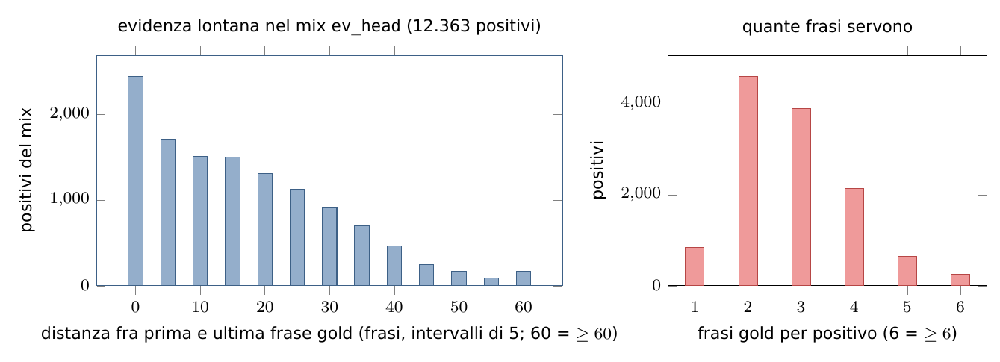

# Passo 4 — Split per documento e mix di training

## In breve

1. **Split** ([`evidence/data/make_splits.py`](../../../evidence/data/make_splits.py)): si decide **una volta per tutte** quali righe servono per addestrare, per scegliere e per misurare. La divisione è **per documento**: lo stesso documento non sta mai in due split.
2. **Mix** ([`evidence/data/make_mix.py`](../../../evidence/data/make_mix.py) con la ricetta [`evidence/recipes/ev_head.json`](../../../evidence/recipes/ev_head.json)): dice quali righe del train vede la loss e con quali pesi. Lo split è congelato; il mix cambia da esperimento a esperimento.

```sh
python -m evidence.data.make_splits                                   # ~4 s
python -m evidence.data.make_mix --recipe evidence/recipes/ev_head.json
```

## 1. Assegnazione deterministica per documento

Ogni documento riceve un numero pseudo-casuale che dipende solo dal seme, da un "sale" e dal suo `doc_id` (`make_splits.unit`):

$$
u(\textit{doc}) = \frac{\mathrm{int}\big(\mathrm{sha256}(\texttt{"13:}\textit{sale}\texttt{:}\textit{doc\_id}\texttt{"})_{[0:8]}\big)}{2^{64}} \in [0, 1).
$$

Una regola come "$u < 0{,}1 \Rightarrow$ dev" dà così uno split al 10% **stabile**: non dipende dall'ordine delle righe e non cambia se se ne aggiungono altre. Sali diversi (`"scifact"`, `"hover"`, `"dev_half"`, `"baseline_half"`) rendono indipendenti le estrazioni.

## 2. Le regole per fonte

| Fonte | Train | Dev | Test |
|----------------|-----------------------------------------|----------------------------------|------------------------------------|
| **SciFact** | $u < 0{,}8$ | $0{,}8 \le u < 0{,}9$ | $u \ge 0{,}9$ |
| **HoVer** | train d'origine, $u \ge 0{,}1$ (`exact` e `db_split`) | train d'origine, $u < 0{,}1$, solo `exact` | dev d'origine, solo `exact` |
| **WiCE** | train d'origine con `aggrefact_overlap is False` | — | dev + test d'origine (fuori dominio) |

Le funzioni sono `assign_scifact`, `assign_hover` e `assign_wice`.

**Perché così (decisioni del 2026-11-04):**

- **SciFact, train e validation uniti.** Lo split d'origine è per **claim**, non per documento: 295 righe su 919 del train condividono l'abstract con la validation. Il test SciFact quindi **non** coincide con la validation ufficiale.
- **HoVer, dev al 10%** (non al 5% del piano): con il 5% `dev_evid_select` avrebbe solo 207 positivi, e una differenza di 1 punto di F1 sarebbe rumore.
- **HoVer `db_split` solo in train.** La frase gold può essere sfasata, quindi queste righe possono addestrare (con peso minore) ma non misurare.
- **WiCE.** Le pagine del dev e del test di WiCE sono quelle di LLM-AggreFact, il benchmark finale. Nel train entra solo una riga con `aggrefact_overlap` esattamente `False`: nel dubbio (`None`) si scarta.

Poi `remove_shared_documents` fa passare ogni documento conteso allo stadio più alto (test > dev > train), e `check` si ferma se resta una sovrapposizione.

## 3. I set (prodotti il 2026-11-04)

| Set | Contenuto | Righe | Uso |
|------------------------|-----------------------------------------|---------------:|-------------------------------|
| `train` | tutto il train, tutte le etichette | 20.717 | input del mix |
| `dev_evid_select` | metà dei positivi del dev (per documento, $u_{dev\_half} < 0{,}5$) | 391 | **tutte** le scelte |
| `dev_evid_confirm` | l'altra metà | 391 | conferma delle scelte |
| `dev_evid_neg` | i negativi del dev | 394 | "negativi accesi" |
| `test_evid_id` | test di SciFact e HoVer, tutte le etichette | 1.902 | misura finale |
| `test_evid_ood` | WiCE dev + test | 1.884 | misura finale fuori dominio |

Righe scartate (dal `manifest.json`): HoVer 720 `dev_db_split`, 2.208 `test_db_split` e 6 righe di train il cui documento è nel test; WiCE 2 righe di train sovrapposte ad AggreFact.

Ogni set ha il suo `.stats.json`: conteggi, frasi gold, distanza fra le frasi gold in frasi (bucket 0–1 / 2–9 / 10–19 / ≥ 20) e lunghezza del prompt. La distanza in token si conosce solo dopo il rendering e la calcola `extract.report` ([06](06_rendering_ed_estrazione.md)).

## 4. Il mix

Ogni riga del train prende la **prima** famiglia della ricetta il cui `match` le corrisponde (`make_mix.matches`, `apply_recipe`). Una chiave di `match` si cerca prima nella riga e poi in `meta`. La famiglia assegna tre campi:

- `evidence_term`: quale loss riceve la riga ([08](08_testa_e_loss.md) §6);
- `row_weight` $w_b$: quanto conta la riga nella media del batch;
- `omega` $\omega$: peso delle frasi **non** gold. È basso dove gli annotatori possono aver dimenticato frasi valide.

| Famiglia | `match` | Termine | $w_b$ | $\omega$ | Righe |
|----------------------|-----------------------------|-------------------|------------:|------------:|-------------:|
| `hover_exact` | hover, label 1, exact | `supervised` | 1,0 | 0,5 | 6.846 |
| `hover_db_split` | hover, label 1, db_split | `supervised` | 0,5 | 0,5 | 3.063 |
| `scifact_pos` | scifact, label 1 | `supervised` | 1,0 | 0,5 | 404 |
| `wice_pos` | wice, label 1 | `supervised` | 1,0 | 0,3 | 2.050 |
| `wice_partial` | `evidence_term = none` | escluse | — | — | 468 |
| `negatives` | label 0, `mil_neg` | `mil_neg` | 1,0 | — | 7.886 |

Totale: **20.249 righe**. Con `neg_fraction` i negativi si possono sottocampionare (`subsample_negatives`): se ne tengono $\mathrm{round}\big(f\cdot P/(1-f)\big)$, dove $P$ è il numero di positivi. Nella ricetta di base vale `null`, cioè si tengono tutti.



*Figura 4 — Nel mix l'evidenza è quasi sempre multi-frase (93% dei positivi ha almeno 2 frasi gold) e spesso lontana (66% con gold a 10 o più frasi di distanza). In media le frasi gold sono il 5,4% delle frasi di un positivo.*

### 4.1 Vincoli (stampati e salvati nel manifest)

| Vincolo | Obiettivo | `ev_head` |
|---------------------------------------|-------------------|---------------------------------------------:|
| quota di negativi | 0,20–0,45 | 0,389 |
| positivi con ≥ 2 frasi gold | ≥ 0,40 | 0,931 |
| positivi con gold a ≥ 10 frasi di distanza | ≥ 0,25 | 0,664 |
| documenti in comune con dev/test | 0 (errore) | 0 |
| righe WiCE sovrapposte ad AggreFact | 0 (errore) | 0 |
| evidenza oltre 1.024 token | ≥ 0,15 | dopo l'estrazione (circa 0,57 sul campione di 300 righe) |

## 5. Codice

| Funzione | File | Ruolo |
|--------------------------------------|---------------------------------------|-----------------------------------------|
| `unit` | `make_splits.py` | hash deterministico per documento |
| `assign_scifact`, `assign_hover`, `assign_wice` | `make_splits.py` | regole per fonte |
| `remove_shared_documents`, `make_sets`, `check` | `make_splits.py` | nessun documento condiviso; i 6 set; controlli |
| `set_stats`, `distance_bucket` | `make_splits.py` | statistiche per set |
| `matches`, `apply_recipe` | `make_mix.py` | famiglie della ricetta |
| `subsample_negatives`, `constraints` | `make_mix.py` | quota di negativi; vincoli |
| test | `tests/test_evidence_splits.py` | regole verificate su righe scritte a mano |
