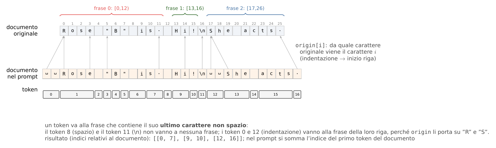

# Passo 6 — Dalle frasi ai token, e salvataggio delle feature

## In breve

1. **Rendering** ([`evidence/render.py`](../../../evidence/render.py)): per ogni riga si costruisce il prompt e si trova, per ogni frase del documento, il **primo e l'ultimo token** che le appartengono nel prompt. È il punto più delicato: con posizioni sbagliate anche di un token, la testa legge i vettori sbagliati.
2. **Estrazione** ([`evidence/extract.py`](../../../evidence/extract.py)): un forward per riga ([01](01_modello_e_hook.md)), con le feature salvate su disco. Il modello è congelato, quindi si calcolano una volta e la testa si addestra su di esse in minuti.
3. **Lettura** ([`evidence/features.py`](../../../evidence/features.py)): le feature si leggono dal disco su richiesta, solo le righe e i layer necessari.

## 1. Il problema

Il documento nel prompt **non è scritto come l'originale**:

- KnowLine mette due spazi davanti a ogni riga;
- c'è il preambolo;
- le richieste corte sono scritte due volte.

Poi il tokenizer spezza il testo in token che non rispettano i confini delle frasi: un token come `."` può chiudere una frase e aprirne un'altra. Servono quindi due mappe: carattere del prompt → carattere originale, e token → frase.



*Figura 6 — Dalla frase (caratteri originali) ai token del prompt. L'indentazione non esiste nell'originale: `origin` la associa al primo carattere della sua riga.*

## 2. Passo per passo (`render.render`)

**(a) Il documento come appare nel prompt** (`document_in_prompt`). Sia $x_0 \ldots x_{m-1}$ il documento originale, diviso in righe come fa `str.splitlines`. Il testo nel prompt è

$$
\tilde x = \texttt{"  "}\,\text{riga}_0 \,\texttt{"\textbackslash n  "}\, \text{riga}_1 \cdots \quad(\text{oppure } \tilde x = x \text{ se non ci sono a capo}),
$$

e per ogni carattere $\tilde x_c$ si registra $\mathrm{origin}(c)$, l'indice del carattere originale da cui viene. I due spazi di indentazione puntano al primo carattere della riga; l'a capo punta all'a capo originale. `tests/test_evidence_render.py` verifica che $\tilde x$ sia identico a `knowline_server.render_value(document, 1)`.

**(b) Dove sta il documento nel prompt.** Si cerca `"document:\n" + x̃` (o `"document: " + x̃`) con `rfind`, cioè l'**ultima** occorrenza: con la lettura doppia è la seconda copia. Il risultato è $c_0$ (`doc_start`).

**(c) Token e offset.** `tok(prompt, return_offsets_mapping=True)` dà per ogni token $t$ l'intervallo $[\alpha_t, \beta_t)$ nella stringa del prompt. Si controlla che gli id siano identici a `tok.encode(prompt)`, cioè a ciò che legge il modello.

**(d) Caratteri originali di ogni token** (`token_char_spans`). Per i token che toccano il documento ($[\alpha_t,\beta_t) \cap [c_0, c_0 + \lvert\tilde x\rvert) \neq \emptyset$), con l'intervallo ritagliato $[\alpha'_t, \beta'_t)$:

$$
\mathrm{span}(t) = \big[\,\mathrm{origin}(\alpha'_t - c_0),\ \mathrm{origin}(\beta'_t - 1 - c_0) + 1\,\big).
$$

**(e) Token → frase** (`sentence_token_spans`). Sia $\gamma_t$ l'**ultimo carattere non spazio** di $\mathrm{span}(t)$. Il token appartiene alla frase che contiene $\gamma_t$:

$$
\phi(t) = k \iff s_k \le \gamma_t < e_k ;\qquad \text{token di soli spazi o fra due frasi: nessuna frase.}
$$

Poi $a_k = \min\{t : \phi(t) = k\}$ e $b_k = \max\{t : \phi(t) = k\}$. La regola dell'ultimo carattere assegna `."` alla frase che chiude, e l'indentazione alla frase della sua riga. Una frase senza token propri (rarissimo) solleva `ValueError`; l'estrazione salta la riga e la conta.

**Uscita** di `render`:

| Chiave | Contenuto |
|-------------------------|------------------------------------------------|
| `prompt`, `input_ids` | il prompt e i suoi token |
| `answer_pos` | $T$, indice dell'ultimo token |
| `sent_tok_spans` | $[a_k, b_k]$ per ogni frase, indici nel prompt, estremi inclusi |
| `n_tok` | $n_k$ |
| `doc_tok_start` | primo token della copia letta: serve per la "distanza in token" |
| `twice` | se la richiesta è stata scritta due volte |
| `label_ids` | id dei token "A" e "B" |

## 3. Estrazione (`extract.py`)

```sh
python -m evidence.extract --rows dataset/evidence/mixes/ev_head.jsonl \
    dataset/evidence/splits/dev_evid_select.jsonl dataset/evidence/splits/dev_evid_confirm.jsonl \
    dataset/evidence/splits/dev_evid_neg.jsonl
```

Per ogni file di righe (un set) si scrive `data/evidence/features/knowline-4b/<set>/`. Per ogni riga: `render_row`, poi `forward_sentences`, poi `index_entry`. Le righe si accumulano in shard da 250 (`SHARD_ROWS`).

### 3.1 Formato su disco

Gli shard sono `safetensors`. I tensori sono **concatenati lungo le frasi** delle righe dello shard, con **un tensore per layer**, così chi legge un solo layer legge solo quello:

| Tensore | Forma ($N$ = frasi dello shard, $R$ = righe) | Tipo |
|-------------------------------------|-----------------------------------------|-------------|
| `h_end.19`, `h_end.23`, `h_end.27`, `h_end.31` | $[N, D]$ | bf16 |
| `h_mean.19` … `h_mean.31` | $[N, D]$ | bf16 |
| `q.19` … `q.31` | $[R, D]$ | fp32 |
| `att` | $[N, 128]$ | fp16 |
| `n_tok` | $[N]$ | int16 |
| `answer_logits` | $[R, 2]$ | fp32 |

Accanto agli shard:

- `index.jsonl`: per ogni riga, shard, riga nello shard, offset della prima frase, $n$, `gold` (0/1 per frase), `evidence_sets`, `evidence_term`, `row_weight`, `omega`, `sent_tok_spans`, `doc_tok_start`, `prompt_tokens`, `twice`, P(supportato) e `shortened`;
- `meta.json`: modello, revisione, preambolo, layer, domanda e sha256 di `sentences.py`, `render.py` e `model.py`;
- `skipped.json`: le righe saltate, con il motivo.

**Spazio occupato:** per frase $2 \times L \times D \times 2$ byte $= 2 \times 4 \times 2560 \times 2 = 40\,\text{KB}$, più 256 byte di attenzione. Con circa 46–52 frasi per riga fanno circa 2 MB per riga (misurato sul campione: 572 MB per 300 righe del mix), quindi circa **40 GB per il mix** e circa **50 GB per tutti i set** (mix + dev + test). Il piano indicava 82 KB per frase e 120 GB, ma $2\times4\times2560\times2$ byte fanno 41 KB: la stima corretta è questa.

**Ripresa e sicurezza:**

- uno shard già scritto non si ricalcola;
- ogni shard si scrive in un `.tmp` e poi si rinomina, così un'interruzione non lascia file rotti;
- se il codice che definisce le feature è cambiato (sha256 diverso in `meta.json`), il programma avvisa.

### 3.2 Righe troppo lunghe

Il limite di estrazione è 16.384 token (`config.MAX_TOKENS_EXTRACT`). Nel mix lo superano 5 righe, tutte WiCE.

- **Righe di training** (del mix): vengono **accorciate** con `shorten`. I positivi perdono frasi non gold, a partire da quelle più lontane da ogni frase gold (ordinate per $-\min_{g\in G}\lvert k - g\rvert$); i negativi perdono le ultime frasi. Si toglie a ogni giro una quantità di token pari circa all'eccesso (+5%) e si ri-renderizza.
- `rebuild(row, keep)` ricostruisce il documento con le frasi tenute: separatore `"\n"` se nell'originale dopo la frase precedente c'era un a capo, altrimenti uno spazio. Rimappa `evidence`, `evidence_sets` e `contra`, e segna `meta.shortened`.
- **Righe di dev e test**: non si tagliano mai. Si saltano e si contano (`too_long`).

Esempio verificato: una riga da 18.715 token passa a 16.068 (da 355 a 306 frasi), e il testo delle frasi gold resta identico.

### 3.3 Velocità

Circa 2,5 righe/s su RTX 5090 Laptop, dove il forward è circa il 95% del tempo e il rendering circa 20 ms per riga. Il mix intero richiede circa 2,3 ore; dev circa 8 minuti; test circa 25 minuti.

## 4. Lettura (`features.FeatureStore`)

```python
store = FeatureStore(".../knowline-4b/ev_head")
row = store.get(i, layers=[31], parts=("end",))   # q [1,D], h_end [n,1,D], h_mean None, att, n_tok, gold, ...
```

Gli shard sono aperti con `safe_open`, cioè in mmap: si leggono dal disco solo gli slice richiesti. Le feature complete (circa 50 GB) non devono stare in RAM (la macchina ne ha 62 GB). Con `layers=[]` non si legge nessun vettore nascosto, cosa che serve alla baseline E-ATT. `same_features(meta_a, meta_b)` dice se due cartelle si possono usare insieme.

## 5. Verifiche

| Verifica | Risultato |
|--------------------------------------------------------------|-----------------------------------------------|
| I token decodificati di ogni frase ridanno la frase (normalizzazione NFKC, al massimo 3 caratteri di bordo) | 1.185 / 1.185 righe di dev e WiCE; 1.500 / 1.500 righe del mix |
| Documenti con `"`, `\`, tab, `<`, emoji, cirillico, greco, giapponese, `\r\n` | corretti (`tests/test_evidence_render.py`) |
| Senza preambolo, prompt identico al benchmark | sì |
| Frasi lette nella seconda copia | sì |
| Forward ripetuto sulla stessa riga | vettori identici |

## 6. Codice

| Funzione | File | Ruolo |
|----------------------------------------------|--------------------|--------------------------------------|
| `document_in_prompt` | `render.py` | $\tilde x$ e `origin` |
| `token_char_spans`, `sentence_token_spans` | `render.py` | passi (d) ed (e) |
| `render`, `render_row`, `check_row` | `render.py` | il rendering completo e il suo controllo |
| `extract_set`, `index_entry`, `save_shard`, `feature_meta`, `report` | `extract.py` | estrazione |
| `shorten`, `rebuild` | `extract.py` | righe lunghe |
| `FeatureStore`, `same_features` | `features.py` | lettura |
