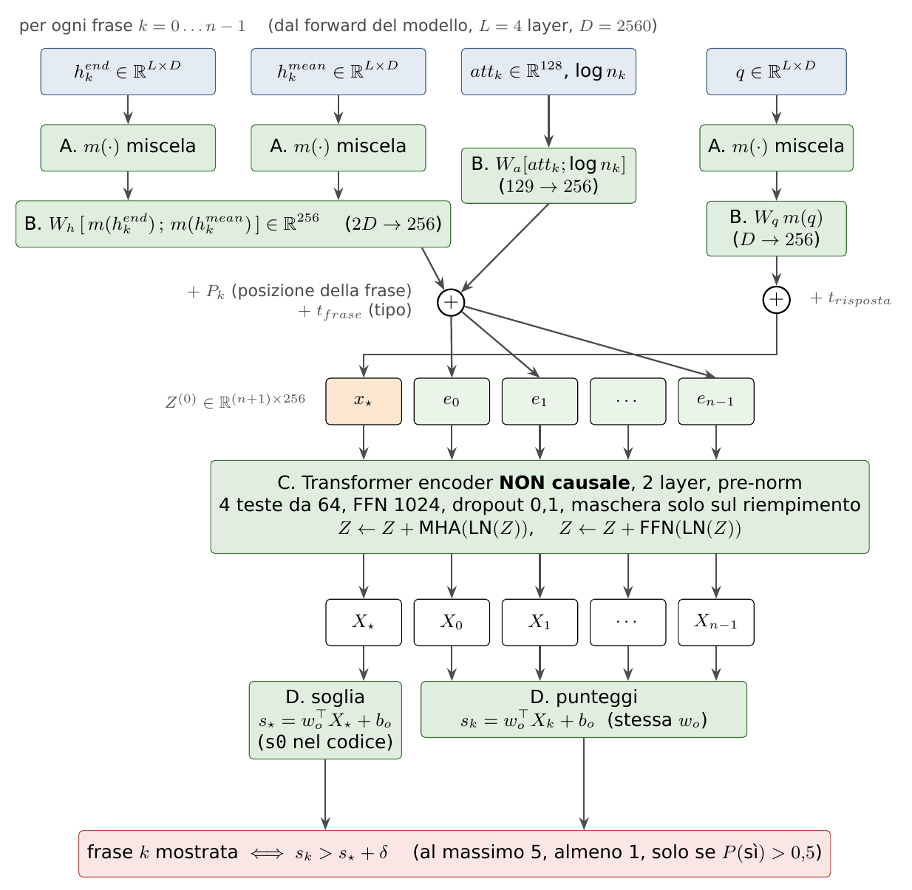
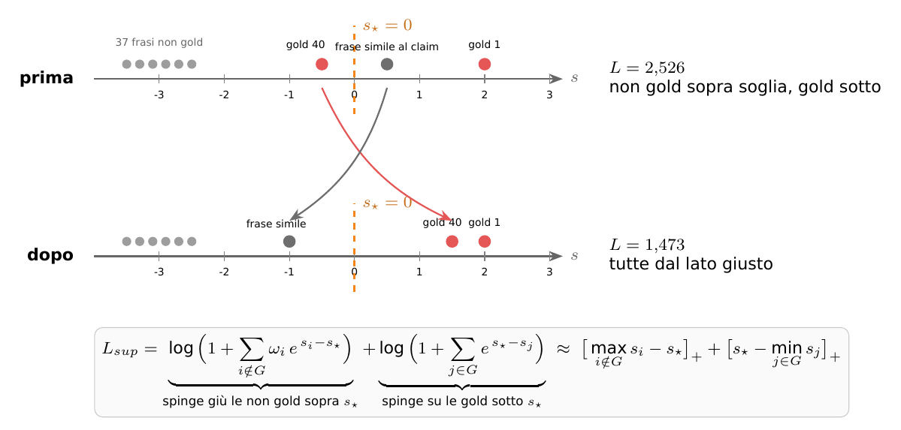

# Passo 8 — L'architettura della testa e la loss

## In breve

La testa ([`evidence/head.py`](../../../evidence/head.py), classe `EvidenceHead`) riceve, per un documento di $n$ frasi, gli ingressi calcolati dal forward del decision model ([01](01_modello_e_hook.md)):

$$
q \in \mathbb{R}^{L\times D},\quad h^{end}_k,\ h^{mean}_k \in \mathbb{R}^{L\times D},\quad att_k \in \mathbb{R}^{128},\quad n_k \in \mathbb{N},\qquad k = 0,\ldots,n-1,
$$

e restituisce un punteggio $s_k$ per frase e una soglia $s_\star$ per il documento. La frase $k$ è evidenza se $s_k > s_\star + \delta$.

La rete ha quattro stadi:

- **A**: miscela dei layer;
- **B**: un vettore per frase;
- **C**: comunicazione fra le frasi;
- **D**: punteggi.

Si addestra con la **loss ZLPR** ([`evidence/losses.py`](../../../evidence/losses.py)), che usa la soglia $s_\star$ come "classe soglia". In questo modo il numero di frasi mostrate si adatta al documento senza una soglia fissa da tarare.

*Figura 7 — La testa di evidenza. Gli ingressi (blu) vengono dal forward del modello; tutto il resto (verde) è addestrato.*

>> Ricordiamo $q$ è lo stato nascosto dell'ultimo token del prompt, cioè della posizione dove KnowLine legge il verdetto, preso nei 4 layer 19, 23, 27 e 31.

>> Forse due matrici di proiezione diverse uno per end e uno per mean.
>> Forse eliminare vettore posizione K ( da testare ) 
## 1. Forme dei tensori

In un batch di $B$ documenti le frasi sono riempite fino al documento più lungo, $N = \max_b n_b$. La maschera $\mathbf{1}_{b,k}$ vale 1 sulle frasi vere.

| Tensore | Forma | Note |
|------------------------|--------------------|--------------------------------------|
| `q` | $[B, L, D]$ | $L = 4$ (o 1 con un solo layer letto) |
| `h_end`, `h_mean` | $[B, N, L, D]$ | bf16 da disco; la testa lavora in fp32 |
| `att` | $[B, N, 128]$ | |
| `n_tok`, `sent_mask` | $[B, N]$ | |
| uscita `s` | $[B, N]$ | valori sul riempimento senza significato |
| uscita `s0` | $[B]$ | $s_\star$ |
| uscita `S` | $[B, N, N]$ o `None` | solo con H-PAIR |

## 2. Gli stadi, in formule

### A. Miscela dei layer (`EvidenceHead.mixed`)

Pesi appresi $\alpha \in \mathbb{R}^{L}$, inizializzati a 0 (quindi 25% ciascuno all'inizio):

$$
\pi = \mathrm{softmax}(\alpha), \qquad
m(V) = \mathrm{LN}\Big(\sum_{l=1}^{L} \pi_l\, V_l\Big) \in \mathbb{R}^{D}, \qquad
\mathrm{LN}(x) = \gamma \odot \frac{x - \mu(x)}{\sigma(x)} + \beta .
$$

- La **stessa** miscela ($\alpha$, $\gamma$, $\beta$) si applica a $h^{end}_k$, $h^{mean}_k$ e $q$, così frasi e risposta sono rappresentate allo stesso modo.
- La LayerNorm serve perché i layer hanno scale molto diverse: l'ultimo ha valori più grandi.
- Con `use_mix=False`: $m(V) = \mathrm{LN}(V_L)$, cioè solo l'ultimo layer letto.
- Dopo il training, `layer_weights()` restituisce $\pi$: un layer sotto il 10% si può togliere ([11](11_esperimenti.md)).

### B. Il vettore di ogni frase e quello della risposta

$$
e_k = \underbrace{W_h \begin{bmatrix} m(h^{end}_k) \\ m(h^{mean}_k) \end{bmatrix} + b_h}_{\text{contenuto: } 2D \to 256}
\;+\; \underbrace{W_a \begin{bmatrix} \xi_k\, att_k \\ \log \max(n_k, 1) \end{bmatrix} + b_a}_{\text{dove ha guardato il modello: } 129 \to 256}
\;+\; \underbrace{P_k}_{\text{posizione}} \;+\; t_{frase},
$$

$$
x_\star = W_q\, m(q) + b_q + t_{risposta}, \qquad e_k,\ x_\star \in \mathbb{R}^{256}.
$$

- **$[m(h^{end}_k); m(h^{mean}_k)]$**: due viste della stessa frase ([01](01_modello_e_hook.md) §3). Con `use_mean=False` resta solo $m(h^{end}_k)$, e $W_h$ è $D \to 256$.
- **$\log n_k$**: una frase lunga raccoglie più attenzione solo perché ha più token; con la lunghezza fra gli ingressi la testa può correggere.
- **$\xi_k \in \{0,1\}$** è un dropout **per frase intera**, solo in training: $\xi_k = 0$ con probabilità 0,1, e allora sparisce tutta l'attenzione di quella frase (senza ri-scalare). Così la testa non dipende da una sola testa di attenzione. Con `use_att=False` il termine manca.
- **$P_k$**: vettore appreso della posizione $k$ della frase (tabella $512 \times 256$). Aiuta con titoli e frasi iniziali. `use_pos=False` lo toglie (esperimento H9).
- **$t_{frase}$, $t_{risposta}$**: vettori di "tipo" (tabella $2 \times 256$), che distinguono $x_\star$ dalle frasi nella sequenza.

### C. Comunicazione fra le frasi: transformer **non causale**

La sequenza è $Z^{(0)} = [x_\star; e_0; \ldots; e_{n-1}] \in \mathbb{R}^{(n+1)\times 256}$, più il riempimento. Seguono due layer `nn.TransformerEncoderLayer` **pre-norm** (`norm_first=True`), con 4 teste da 64, FFN da 1.024, ReLU e dropout 0,1. Per $r = 1, 2$:

$$
U = Z^{(r-1)} + \mathrm{Drop}\Big(\mathrm{MHA}\big(\mathrm{LN}_1(Z^{(r-1)})\big)\Big),
$$

$$
Z^{(r)} = U + \mathrm{Drop}\Big(W_2\,\mathrm{Drop}\big(\mathrm{ReLU}(W_1\,\mathrm{LN}_2(U) + b_1)\big) + b_2\Big),
$$

$$
\mathrm{MHA}(Y) = \big[\mathrm{head}_1; \ldots; \mathrm{head}_4\big] W_O,\qquad
\mathrm{head}_h = \mathrm{softmax}\Big(\frac{(Y W^h_Q)(Y W^h_K)^\top}{\sqrt{64}} + M\Big)\, Y W^h_V,
$$

$$
M_{ij} = 0 \ \text{se la posizione } j \text{ è vera}, \qquad M_{ij} = -\infty \ \text{se } j \text{ è riempimento}.
$$

Le uscite sono $X_\star = Z^{(2)}_0$ e $X_k = Z^{(2)}_{k+1}$. Dopo l'ultimo layer non c'è una LayerNorm finale (`TransformerEncoder` con `norm=None`).

**Non causale** significa che non c'è maschera triangolare: ogni frase guarda **tutte** le altre, in avanti e indietro, e anche $x_\star$. È il pezzo che risolve l'evidenza sparsa. Nell'esempio della [00](00_overview.md):

- nel modello, il vettore della frase 0 ("Saint Paul School of Theology is a seminary located in Kansas City") è stato calcolato **prima** di leggere la frase 4. Sa del seminario, non di Nancy Howell;
- nel transformer della testa, $e_0$ può dare attenzione a $e_4$ ("Nancy R. Howell is Professor of Theology at Saint Paul School of Theology"): le due condividono l'entità "Saint Paul School of Theology";
- $x_\star$ porta il punto di vista del verdetto: la posizione di risposta ha letto tutto e sa su cosa si è basata.

Dopo due layer, $X_0$ "sa" di far parte di una catena con la frase 4, e il suo punteggio può salire anche se da sola non nomina Nancy Howell.

Con `layers=0` (esperimento H3a) il transformer non c'è: $X_k = e_k$, cioè ogni frase è giudicata da sola.

### D. Punteggi e soglia

$$
s_k = w_o^\top X_k + b_o, \qquad s_\star = w_o^\top X_\star + b_o, \qquad w_o \in \mathbb{R}^{256}.
$$

La **stessa** uscita lineare dà i punteggi e la soglia: sono sulla stessa scala, quindi $s_k - s_\star$ ha senso. La soglia è diversa per ogni documento. Con un claim che richiede 3 frasi, $X_\star$ (che ha visto quante parti servono) può abbassarla per farle passare tutte.

**Regola di selezione** (`metrics.select`): con $\theta = s_\star + \delta$,

$$
\mathcal{S} = \mathrm{top}_5\{k : s_k > \theta\}, \qquad \text{e se } \mathcal{S} = \emptyset:\ \mathcal{S} = \{\arg\max_k s_k\},
$$

applicata solo se $P(\text{supportato}) > 0{,}5$. Il server riporta per ogni frase il punteggio $\sigma(s_k - \theta)$.

### Facoltativo: punteggio per coppie (H-PAIR, `use_pair=True`)

$$
S_{kj} = (U_1 X_k)^\top (U_2 X_j),\quad U_1, U_2 \in \mathbb{R}^{64\times 256};\qquad
s_k \leftarrow s_k + \tau \cdot \max_{j \neq k,\ j \text{ vera}} \big(S_{kj} + \mathrm{sg}(s_j)\big),
$$

con $\tau$ appreso (iniziale 0,1) e $\mathrm{sg}$ = *stop gradient* (`s.detach()`). Senza partner il contributo è 0. La frase $k$ sale se c'è un'altra frase con cui "fa coppia" e che a sua volta ha un punteggio alto.

## 3. Parametri (KnowLine-4B, $D = 2560$; calcolati da `EvidenceHead`)

| Componente | Formula | Parametri |
|----------------------------------|--------------------------------|-------------------------------:|
| A. $\alpha$ | $L$ | 4 |
| A. LayerNorm | $2D$ | 5.120 |
| B. $W_h, b_h$ | $2D \cdot 256 + 256$ | 1.310.976 |
| B. $W_q, b_q$ | $D \cdot 256 + 256$ | 655.616 |
| B. $W_a, b_a$ | $129 \cdot 256 + 256$ | 33.280 |
| B. $P$ (512 posizioni) | $512 \cdot 256$ | 131.072 |
| B. tipi $t$ | $2 \cdot 256$ | 512 |
| C. transformer, per layer | MHA $4\cdot256^2 + 4\cdot256$; FFN $2\cdot256\cdot1024 + 1024 + 256$; 2 LN $4\cdot256$ | 789.760 |
| C. transformer, 2 layer | | 1.579.520 |
| D. $w_o, b_o$ | $257$ | 257 |
| **Totale** (configurazione completa) | | **3.716.357** (14,9 MB in fp32) |
| H0 (1 layer, solo $h^{end}$) | | 3.060.994 |
| H3a (senza transformer) | | 2.136.837 |
| + H-PAIR | $2 \cdot 64 \cdot 256 + 1$ | + 32.769 |

**Costo.** Circa $2 \cdot 2D \cdot 256 \approx 2{,}6$ MFLOP per frase in $W_h$, più il transformer su $n+1 \le 513$ elementi da 256. Misurato nel server: **1,1 ms** per documento (p50), contro circa 340 ms del forward del modello.

**Invarianza al riempimento.** Grazie alla maschera $M$, i punteggi di un documento non cambiano se nel batch c'è un documento più lungo. È verificato (`test_padding_invariance`, differenza < $10^{-4}$).

## 4. Interruttori e configurazioni

| Opzione di `EvidenceHead` | Default | Effetto | Esperimento |
|-----------------------------|----------------|------------------------------------------|--------------------|
| `use_mix` | True | False = solo l'ultimo layer letto | H0 / H2a |
| `use_mean` | True | False = solo $h^{end}$ | H2c |
| `use_att` | True | False = niente $att_k$ | H2b |
| `use_pos` | True | False = niente $P_k$ | H9 |
| `layers` | 2 | 0 = niente transformer; 1 o 4 | H3a, H3c |
| `use_pair` | False | punteggio per coppie | H-PAIR |
| `att_dropout`, `dropout` | 0,1 | dropout per frase su $att$; dropout nel transformer | |

Le configurazioni stanno in [`evidence/configs/`](../../../evidence/configs/). `build_head(cfg, d_model)` costruisce la testa da una configurazione; `load_run(dir)` ricarica una testa addestrata.

## 5. La loss

### 5.1 Tipi di riga e pesi

Ogni riga del mix ([04](04_split_e_mix.md) §4) ha un termine (`TERMS` in `losses.py`), un peso di riga $w_b$ e un peso $\omega$ per le frasi non gold:

| Termine | Righe | Che cosa chiede |
|----------------------|-----------------------------------------|---------------------------------------|
| `supervised` (0) | positivi con evidenza nota | le frasi di $G$ sopra $s_\star$, le altre sotto |
| `mil_neg` (1) | negativi | **nessuna** frase sopra $s_\star$ |
| `mil_pos` (2) | positivi senza evidenza (non usato di default) | almeno una frase sopra $s_\star$, ma poche |
| `none` (3) | WiCE parziali (già tolte dal mix) | niente |

La loss del batch (`train_head.batch_loss`) è la media pesata sulle righe che hanno un termine:

$$
\mathcal{L}_{batch} = \frac{\sum_b w_b\, \ell_b}{\sum_b w_b\, \mathbb{1}[\ell_b \text{ attivo}]}.
$$

Con la loss di riferimento sono attive solo le righe `supervised`; con ZLPR tutte tranne `none`.

### 5.2 Loss di riferimento (H0): per frase, con soglia fissa (`ref_loss`)

Ogni frase è un sì/no indipendente. Con $y_k = \mathbb{1}[k \in G]$ e $\mathrm{BCE}(s, y) = -y\log\sigma(s) - (1-y)\log(1-\sigma(s))$:

$$
\ell_{ref} = \frac{1}{n}\sum_{k} c_k\, \mathrm{BCE}(s_k, y_k) \;+\; \gamma\,\frac{1}{\lvert G\rvert}\sum_{j \in G} \mathrm{softplus}\Big(\mu - s_j + \max_{i \notin G} s_i\Big),
\qquad c_k = \begin{cases}\alpha & k \in G\\ \omega & k \notin G\end{cases}
$$

con $\alpha = 10$, $\gamma = 0{,}5$ e $\mu = 1$:

- **$\alpha$**: le frasi gold sono poche (il 5,4%), e senza peso la testa imparerebbe a dire sempre "no";
- **termine di ordinamento**: ogni frase gold deve superare di un margine $\mu$ la migliore non gold.

In uso, la frase è mostrata se $\sigma(s_k) > \tau_e$, con $\tau_e$ scelto sul dev ([09](09_training.md) §3). Qui $s_\star$ non si usa.

### 5.3 Loss principale: ZLPR con soglia del documento (`zlpr_loss`)

Con $d_k = s_k - s_\star$ (distanza dalla soglia):

$$
\ell_{sup} = \log\Big(1 + \sum_{i \notin G} \omega_i\, e^{d_i}\Big) + \log\Big(1 + \sum_{j \in G} e^{-d_j}\Big),
$$

$$
\ell_{neg} = \mu_{neg}\,\log\Big(1 + \sum_{i} e^{d_i}\Big),\qquad
\ell_{pos} = \mu_{pos}\Big[\log\big(1 + e^{-\mathrm{LSE}_i\, d_i}\big) + \rho\,\frac{1}{n}\sum_i \sigma(d_i)\Big],
$$

con $\mu_{neg} = \mu_{pos} = 0{,}3$, $\rho = 0{,}1$ e $\mathrm{LSE}_i\, x_i = \log\sum_i e^{x_i}$. Nel codice ogni termine è scritto come $\mathrm{softplus}(\mathrm{LSE}(\cdot))$, numericamente stabile: $\log(1 + \sum_i e^{x_i}) = \mathrm{softplus}(\mathrm{LSE}_i\, x_i)$, e $\omega$ entra come $+\log\omega_i$ dentro il LSE.

*Figura 8 — La loss ZLPR sull'esempio numerico del test (40 frasi, evidenza = frasi 1 e 40, $\omega = 1$). Prima: la gold 40 è sotto la soglia e una frase simile al claim è sopra, $L = 2{,}526$. Dopo: tutte dal lato giusto, $L = 1{,}473$.*

**Perché funziona.**

1. **È un hinge morbido sul caso peggiore.** Siccome $\log(1+\sum_i e^{x_i}) \approx \max(0, \max_i x_i)$,

   $$
   \ell_{sup} \approx \big[\max_{i\notin G} d_i\big]_+ + \big[-\min_{j \in G} d_j\big]_+ .
   $$

   La loss è circa 0 solo quando **tutte** le non gold stanno sotto $s_\star$ e **tutte** le gold sopra. Per l'evidenza sparsa conta proprio questo: una gold sotto soglia (metà evidenza) costa quanto una non gold sopra.

2. **Il gradiente va a chi sbaglia di più.** Per una non gold e una gold:

   $$
   \frac{\partial \ell_{sup}}{\partial s_i} = \frac{\omega_i e^{d_i}}{1 + \sum_{i'\notin G}\omega_{i'} e^{d_{i'}}}\quad (i\notin G),\qquad
   \frac{\partial \ell_{sup}}{\partial s_j} = -\frac{e^{-d_j}}{1 + \sum_{j'\in G} e^{-d_{j'}}}\quad (j\in G).
   $$

   È una softmax in cui la soglia è una "classe" con logit 0: la frase non gold più sopra la soglia riceve la spinta maggiore verso il basso. Le frasi già ben sotto soglia ricevono un gradiente quasi nullo, quindi le 45 frasi irrilevanti di un documento non diluiscono il segnale (con la BCE invece contano tutte).

3. **La soglia si sposta da sola.** $\partial\ell_{sup}/\partial s_\star = -\sum_{i\notin G}\partial\ell/\partial s_i - \sum_{j\in G}\partial\ell/\partial s_j$: $s_\star$ sale se pesano di più le non gold sopra soglia, scende se pesano di più le gold sotto. Il numero di frasi mostrate si adatta al documento.

4. **$\omega < 1$** abbassa la penalità per le frasi non gold sopra soglia. Dove le annotazioni sono incomplete (WiCE, $\omega = 0{,}3$), una frase valida ma non annotata non viene punita troppo.

5. **`mil_neg`** è lo stesso primo termine con tutte le frasi. Sui claim non supportati nessuna frase deve superare la soglia, anche se somiglia al claim. È ciò che fa scendere i "negativi accesi" (sul campione di 300 righe da 0,95 con H0 a 0,35 con H2c).

**Rischio.** $x_\star$ conosce il verdetto, quindi con `mil_neg` la testa può imparare "se il verdetto è no, alza la soglia". È coerente con l'obiettivo, perché l'evidenza si mostra solo sui supportati. Sui positivi **incerti** ($P$ appena sopra 0,5), però, la testa può spegnersi. Per questo si misura `recall_uncertain` ([10](10_valutazione.md)) e, se serve, si abbassa $\mu_{neg}$.

### 5.4 Termine per le coppie (H-PAIR, `pair_loss`, peso 0,2)

Sulle righe con almeno 2 frasi gold:

$$
\ell_{pair} = \underbrace{\mathrm{BCE}\big(S_{kj}, 1\big)_{k \ne j \in G}}_{\text{coppie gold}} + \underbrace{\mathrm{BCE}\big(S_{kj}, 0\big)_{k\in G,\ j \in \mathrm{top}_5^{S_{k\cdot}}(\bar G)}}_{\text{per ogni gold, le 5 non gold più "vicine"}}.
$$

### 5.5 Esempi numerici (test automatici in `tests/test_evidence_head.py`)

| Caso | Valore |
|-----------------------------------------------------|--------------------------:|
| `ref_loss`, 40 frasi, gold = {1, 40}, tutte con $\sigma(s) = 0{,}02$, $\alpha = 10$, $\omega = 1$, solo BCE: $(10 \cdot 2 \cdot 3{,}912 + 38 \cdot 0{,}020)/40$ | **1,975** |
| `zlpr_loss` "prima" (fig. 8): $\log(1 + e^{0{,}5} + 37e^{-3}) + \log(1 + e^{-2} + e^{0{,}5}) = 1{,}502 + 1{,}024$ | **2,526** |
| `zlpr_loss` "dopo": $\log(1 + e^{-1} + 37e^{-3}) + \log(1 + e^{-2} + e^{-1{,}5}) = 1{,}166 + 0{,}306$ | **1,473** |
| `mil_neg` con tutte le frasi a $d = -20$ | $< 10^{-6}$ |
| riga `none` | loss 0, gradiente 0 |

## 6. Codice

| Funzione / classe | File | Ruolo |
|-------------------------------------------|--------------------------------------|-------------------------------------------|
| `EvidenceHead.__init__`, `forward`, `mixed`, `layer_weights` | `head.py` | stadi A–D, H-PAIR |
| `build_head`, `load_run` | `head.py` | da configurazione / da run |
| `ref_loss`, `zlpr_loss`, `pair_loss`, `TERMS` | `losses.py` | §5 |
| `select` | `metrics.py` | regola di selezione |
| test | `tests/test_evidence_head.py` | forme, riempimento, esempi numerici, gradiente zero |
